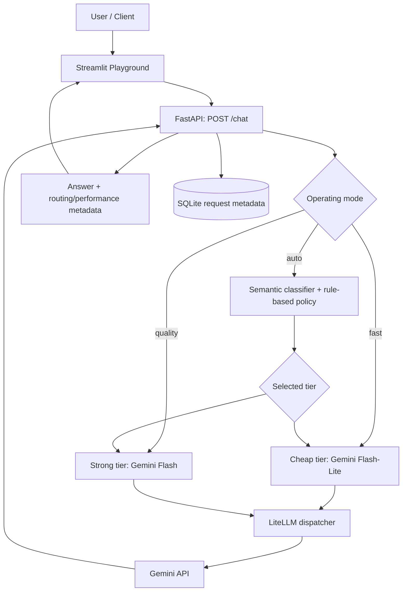

# RouteWise

**A multi-mode LLM gateway for model selection, inference, and request observability.**

RouteWise sits between an application and a language-model provider. It exposes a FastAPI endpoint that accepts a prompt, selects a Gemini model according to the requested operating mode, dispatches the request through LiteLLM, and returns the answer together with routing and performance metadata. A Streamlit interface provides an interactive playground for trying the modes.

> **Project status:** Working student prototype. The gateway, three operating modes, Streamlit playground, and SQLite metadata logging are implemented. The automatic routing policy is a heuristic baseline; it has not been demonstrated to outperform fixed-model selection on a sufficiently large held-out evaluation.

## Features

- **Three operating modes**
  - `fast`: selects the configured `cheap` tier (Gemini Flash-Lite).
  - `quality`: selects the configured `strong` tier (Gemini Flash).
  - `auto`: uses the existing semantic classification and rule-based tier-selection pipeline.
- **FastAPI gateway** with request validation and structured responses.
- **LiteLLM dispatch** to the configured Gemini model variants.
- **Streamlit playground** for submitting prompts and viewing answers, the selected model, routing explanation, latency, token usage, and request ID.
- **SQLite observability** for request metadata, model selection, status, latency, token usage, estimated cost, and error category. Prompt text, generated answers, API keys, and raw provider error messages are not stored by the observability layer.
- **Automated tests** for routing modes, API contracts, dispatch failures, and observability.
- **Paired evaluation tooling** to compare model responses on the same prompts.

## Architecture



### Request flow

1. The client submits a prompt and an optional mode to `POST /chat`.
2. `fast` and `quality` select a model tier directly. `auto` runs the existing semantic-plus-rules routing pipeline.
3. The selected tier is mapped to a model ID in `app/config.py`.
4. `app/dispatcher.py` calls the model through LiteLLM.
5. The API returns the answer, selected model, routing method, reason, latency, and provider-reported token usage when available.
6. Request metadata is recorded in SQLite, including failed requests.

## Technology stack

- Python 3.11
- FastAPI and Uvicorn
- Streamlit
- LiteLLM
- Google Gemini API
- Sentence Transformers (`all-MiniLM-L6-v2`) for semantic classification
- SQLite
- Pydantic
- Pytest

## Project structure

```text
routewise-llm-router/
├── app/
│   ├── main.py                 # FastAPI application and endpoints
│   ├── schemas.py              # Request and response schemas
│   ├── config.py               # Model mapping and configuration
│   ├── routing.py              # Rule-based routing baseline
│   ├── semantic.py             # Semantic task classification
│   ├── dispatcher.py           # LiteLLM model dispatch
│   ├── observability.py        # SQLite request metadata
│   └── pricing.py              # Estimated token-cost calculation
├── frontend/
│   └── streamlit_app.py        # Streamlit playground
├── .streamlit/
│   └── config.toml             # Streamlit theme
├── data/
│   ├── evaluation_dataset.jsonl
│   ├── evaluation_dataset_metadata.json
│   └── README_evaluation.md
├── reports/                    # Local benchmark outputs (not source code)
├── scripts/                    # Dataset and benchmark utilities
├── tests/                      # Automated tests
├── .env                        # Local secrets; do not commit
├── .gitignore
├── requirements.txt
└── README.md
```

The exact set of files may evolve as the project is maintained. Generated databases, local secrets, caches, and large model files should remain outside version control.

## Getting started

### Prerequisites

- Windows, macOS, or Linux
- Python 3.11
- A Gemini API key
- Git

### 1. Clone the repository

```bash
git clone <YOUR_GITHUB_REPOSITORY_URL>
cd routewise-llm-router
```

### 2. Create and activate the Conda environment

```bash
conda create -n routewise python=3.11 -y
conda activate routewise
```

If you already have the `routewise` environment, simply run `conda activate routewise`.

### 3. Install dependencies

```bash
python -m pip install -r requirements.txt
```

### 4. Configure the API key

Create a `.env` file in the project root:

```env
GEMINI_API_KEY=your_gemini_api_key_here
```

Keep `.env` private. Never commit API keys or paste them into issue reports. The repository should include only a placeholder `.env.example`, if one is provided.

### 5. Start the FastAPI backend

In the first terminal, from the project root:

```bash
conda activate routewise
python -m uvicorn app.main:app --host 127.0.0.1 --port 8000
```

The API is available at `http://127.0.0.1:8000`.

- Health check: `http://127.0.0.1:8000/health`
- Interactive API docs: `http://127.0.0.1:8000/docs`

### 6. Start the Streamlit frontend

Open a second terminal in the project root:

```bash
conda activate routewise
python -m streamlit run frontend/streamlit_app.py
```

Open `http://localhost:8501` in your browser. The frontend calls the local FastAPI backend. To use a different backend URL, set the `ROUTEWISE_API_URL` environment variable before starting Streamlit.

## API endpoints

| Method | Endpoint | Purpose |
|---|---|---|
| `GET` | `/` | Basic service information |
| `GET` | `/health` | Health check |
| `POST` | `/route` | Rule-based routing decision without model generation |
| `POST` | `/route/semantic` | Semantic category plus rule-based tier decision |
| `POST` | `/chat` | Select a mode, dispatch to a model, and return the answer |

### Example: chat request

```json
{
  "prompt": "Explain binary search with a simple example.",
  "mode": "fast"
}
```

`mode` accepts `auto`, `fast`, or `quality`. If omitted, it defaults to `auto`.

### Response fields

A successful `/chat` response includes:

- `answer`
- `model`
- `task_category` (null for manual modes)
- `model_tier`
- `routing_method` (`semantic_plus_rules`, `manual_fast`, or `manual_quality`)
- `similarity_score` (null for manual modes)
- `reason`
- `latency_ms`
- `usage` (may be null if the provider does not report token usage)

The API also returns an `X-Request-ID` response header.

## Testing

Run the complete test suite from the project root:

```bash
python -m pytest -q
```

The tests mock model calls where appropriate; running the test suite should not require live Gemini requests or consume model quota.

## Evaluation and experimental findings

RouteWise includes a small paired-model evaluation workflow. Each prompt is sent to both configured model variants directly through the dispatcher, bypassing the automatic router, so their outputs and operational metrics can be compared on the same input.

The exploratory dataset contains:

- **20 GSM8K prompts** from the `test` split. The prompt is adapted with a final-answer formatting instruction and evaluated by numerical answer matching.
- **20 IFEval prompts** from the `train` split. The original prompt and instruction metadata are preserved for a separate instruction-following evaluation.

The selected samples use pinned dataset revisions and a fixed sampling seed. Duplicate IFEval rows at the selected revision were removed by the original dataset key before sampling.

### Pilot result status

- 80 model calls were attempted across 40 prompts and two model variants.
- 78 calls succeeded after retrying recoverable provider failures.
- 38 prompts have complete paired responses; two Flash responses remain unavailable.
- In the 19 complete GSM8K pairs, both models answered 18 questions correctly and Flash alone answered one additional question correctly.
- The IFEval sample is exploratory. Do not interpret preliminary local checks as official IFEval benchmark scores; a run of the official evaluator is required before reporting official IFEval results.

This is a small exploratory sample, not a statistically conclusive benchmark. It does not establish that automatic routing generalises or outperforms always selecting one model. The current `auto` mode is a semantic-plus-rules baseline, not a trained predictive model-selection system.

## Observability and limitations

The SQLite observability layer records request metadata such as request ID, timestamp, status, routing method, task category, selected tier/model, latency, token usage, estimated cost, and error category. It intentionally does not store prompts, model responses, API keys, or raw provider error messages.

Cost values are estimates from the project's pricing configuration, not billing statements. Provider rate limits, availability, and latency can affect results, especially on free-tier access.

RouteWise is a local development prototype. It does not currently provide user authentication, multi-tenant isolation, production rate limiting, or cross-provider routing. Do not expose the local API publicly without adding appropriate security controls.

## Future improvements

- Run the official IFEval evaluator and publish reproducible results.
- Expand evaluation with a held-out set before making claims about generalisation.
- Evaluate whether a learned router provides measurable value over fixed-model baselines.
- Add production safeguards such as authentication, quotas, and deployment configuration if the project is taken beyond a local prototype.

## Responsible use

Keep API credentials in environment variables or an untracked `.env` file. Review dataset licences and provider terms before redistributing evaluation data or using the project with sensitive prompts.
